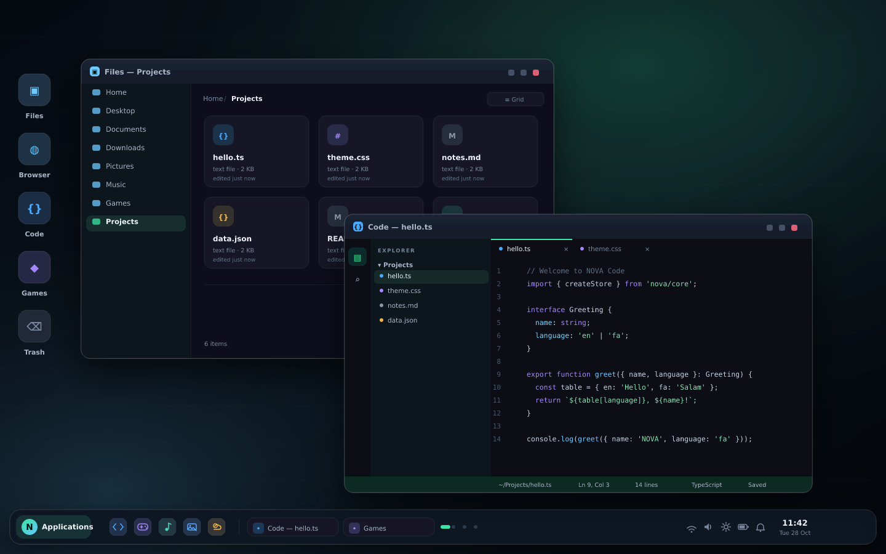
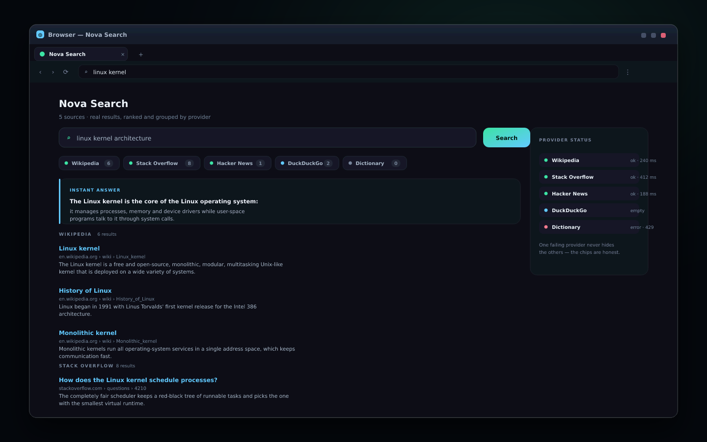
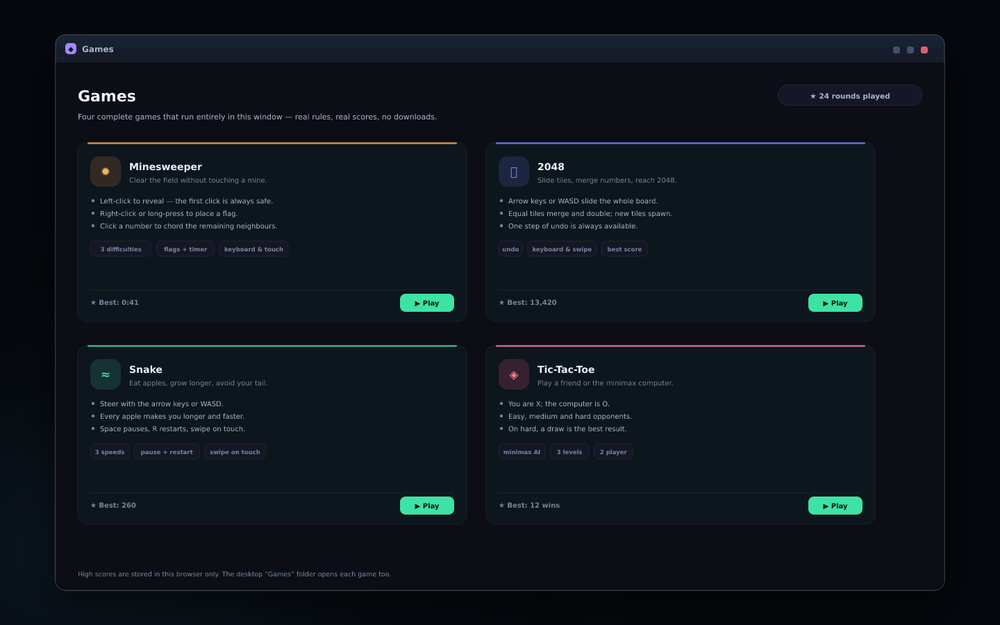
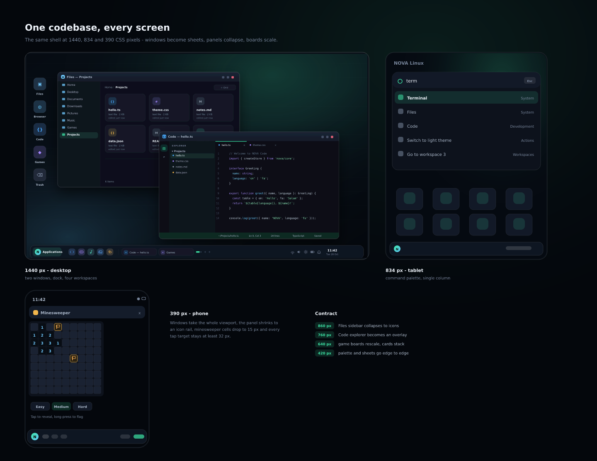

<div align="center">

# NOVA Linux

**A complete Linux desktop environment that boots, runs and remembers — entirely in your browser.**

[](https://hoseinsedaqat.github.io/Linux-OS/)
[](#testing)
[](#tech-stack)
[](#tech-stack)
[](#tech-stack)

Boot splash · login · window manager · 20 working applications · four virtual desktops · a real
file system that survives a reload · live search · an installable offline PWA.

**No backend. No accounts. No API keys. No tracking. Nothing leaves your browser** except the
public APIs the search engine and the weather app query on your behalf.

[**Open the live demo →**](https://hoseinsedaqat.github.io/Linux-OS/)

</div>



---

## Table of contents

- [What this is (and is not)](#what-this-is-and-is-not)
- [Highlights](#highlights)
- [Screens](#screens)
- [Applications](#applications)
- [Code — the built-in editor](#code--the-built-in-editor)
- [Responsive by contract](#responsive-by-contract)
- [The shell](#the-shell)
- [Search that is actually real](#search-that-is-actually-real)
- [Quick start](#quick-start)
- [Deploying to GitHub Pages](#deploying-to-github-pages)
- [Project structure](#project-structure)
- [Persistence model](#persistence-model)
- [Tech stack](#tech-stack)
- [Keyboard shortcuts](#keyboard-shortcuts)
- [Testing](#testing)
- [Honest limitations](#honest-limitations)
- [Regenerating the illustrations](#regenerating-the-illustrations)

---

## What this is (and is not)

NOVA Linux is a **desktop environment simulator**: a web application that behaves like a small,
polished Linux distribution. It has a boot sequence, a login screen, a window manager, a panel with
workspaces, twenty applications, a virtual file system persisted in IndexedDB, and a light/dark
theme engine with a custom accent colour studio.

It is **not** a Linux kernel, a VM, or a remote desktop. Nothing is executed natively, no real file
or hardware is touched, and no password is ever collected or stored. Every place where that
distinction matters — the terminal, the system monitor, battery/network readings, brightness — says
so plainly in the UI instead of pretending.

What *is* real: the editing and saving of documents, the spreadsheet engine, the games' rules and
scores, the drawing and layout of the shell, the file system, the service-worker cache, and the
network calls the search engine and weather app make to public, keyless, CORS-enabled APIs.

---

## Highlights

- **A shell that feels like an OS, not a dashboard.** Boot POST table → login → animated session
  intro → floating glass dock, edge tiling, Exposé overview, four workspaces, notification center,
  Quick Settings, on-screen displays, screen lock, shutdown/restart/power-off states.
- **20 working applications.** Office suite, code editor, file manager, browser with a real search
  engine, notes, Persian accounting ledger, four complete games, music synth, photo gallery, live
  weather, terminal, settings with 14 sections.
- **Persistence that survives a reload.** Documents, notes, images, trash, browser tabs, ledger and
  preferences are stored in IndexedDB + LocalStorage — with a warning banner when storage is blocked.
- **Honest network behaviour.** Search queries five providers in parallel and shows a per-provider
  status rail (*ok / empty / error + HTTP code*). Weather is Open-Meteo. Failure states are designed,
  never faked.
- **Installable PWA with an offline shell.** Manifest, maskable icons, app shortcuts, network-first
  navigations with an offline fallback, stale-while-revalidate assets.
- **Accessibility and motion care.** Full keyboard navigation, labelled controls (audited by tests),
  reduced-motion support in every animated surface, high-contrast mode, UI/text scaling.
- **Bilingual.** English ⇄ فارسی with a complete RTL flip, Persian calendar formatting and a
  Vazirmatn font stack.

---

## Screens

**The desktop** — Files and Code side by side, dock, workspace dots, tray with volume/brightness/
battery/notifications and the clock.


**Nova Search** — five providers queried in parallel, results grouped by source, honest per-provider
status (including a deliberate failure so you can see how one bad API never hides the rest).



**Games** — four complete games with real rules, difficulty levels, keyboard *and* touch input and
persisted best scores.



**One codebase, every screen** — the same shell at 1440, 834 and 390 CSS pixels.



> The images above are **illustrations drawn from the project's own design tokens** (colours,
> gradients, window chrome, spacing) by `tools/make_previews.py`, committed as SVG + PNG. They are
> generated from the same palette the app uses, but they are not browser screenshots — the sandbox
> that builds this project has no browser. Open the live demo for the real thing.

---

## Applications

| Application | What actually works |
| --- | --- |
| **Files** | Every home folder + Desktop/Documents/Downloads/Pictures/Music/Videos/Notes/Favorites/Recent/Applications/Trash. Grid & list views, breadcrumbs, history, search, multi-select, drag & drop move, copy/cut/paste, duplicate, rename, trash/restore/permanent delete, details pane, inline image preview, "New file of any supported kind". |
| **Code** | The new editor: file explorer over `~/Projects`, tabs, dirty indicators, syntax highlighting for TS/JS/JSON/CSS/HTML/MD/SH, find panel, line numbers, `Ctrl+S`/`Ctrl+F`, `Tab`/`Shift+Tab` indent, status bar with language, cursor position and save state. See [below](#code--the-built-in-editor). |
| **Browser** | Tabs, back/forward/reload/home, bookmarks, history, downloads, new-tab page, embedded pages where the site allows framing, a clear explanation when `X-Frame-Options`/CSP blocks it, and Nova Search. |
| **Writer** | Rich text with headings, bold/italic/underline, lists, alignment, colours, links, tables, find & replace, word/character count, print, save to the virtual FS, export TXT/HTML. |
| **Calc** | 40 × 16 grid, formula bar, `SUM/AVERAGE/MIN/MAX/COUNT/ABS/ROUND/SQRT/PI`, ranges, dependency-based recalculation, circular-reference detection, cell styling, row/column insert/delete, multiple sheets, CSV import/export. |
| **Impress** | Slide CRUD and reordering, layouts, text/shape inserts, themes, backgrounds, thumbnails, full-screen slide show with keyboard control, autosave, JSON export. |
| **Notes** | Create, edit, search, pin, colour, delete, autosave with timestamps, TXT export, opens `.novanote` from Files. |
| **Accounting** | Persian RTL small-business ledger: dashboard KPIs and chart, customers, suppliers, products, invoices with line items and tax, payment status, partial payments, printing, transactions, payments, accounts, reports with CSV export, JSON backup/import. Sample data is labelled as sample data. |
| **Games** | Minesweeper (3 board sizes, safe first click, flood reveal, flags, chording, best times), 2048 (full merge/lock rules, swipe, undo, best score), Snake (three speeds, acceleration, pause, D-pad), Tic-Tac-Toe (two players or easy/medium/full-minimax). `~/Games` holds real launcher files. |
| **Music** | Bundled tracks synthesised with Web Audio, live analyser visualiser, playlist from `~/Music`, play/pause/next/previous, volume. Clearly a demo player. |
| **Photos** | Gallery over `~/Pictures`: thumbnails, keyboard navigation, zoom, rotate, details, set-as-wallpaper. |
| **Weather** | Live Open-Meteo data: now, 24-hour strip, 7-day list, city search, saved cities, explicit retry states. |
| **Settings** | Appearance (theme, accent studio, radius, transparency, sounds), Desktop & Panel, Display, Brightness, Wallpapers, Fonts, Keyboard layout, Language, Date & Time, Notifications, Storage (export/import/backup/restore/clear), Privacy, Accessibility, About. |
| **Terminal** | A simulated shell over the virtual FS: `help`, `ls`, `cd`, `pwd`, `mkdir`, `touch`, `cat`, `echo >`, `history`, `neofetch`, `open` — and a polite refusal for `sudo`. |
| **System apps** | Calculator, Calendar (events, colours, month view), System Monitor (labelled *simulated*), Software Center (install/remove apps, updates the menu), Trash, Welcome. |

---

## Code — the built-in editor

`Code` is a real editor over the virtual file system, not a textarea with a fancy frame:

- **Explorer** over `~/Projects`, seeded with `hello.ts`, `theme.css`, `notes.md` and `data.json`;
  arrow keys and `Enter` open files, `←` collapses a folder.
- **Tabs** with per-file dirty dots, `Ctrl+W`-style closing via the tab's `×`, and a guard when you
  close a file with unsaved changes.
- **Syntax highlighting** for TypeScript, JavaScript, JSON, CSS, HTML, Markdown and shell, produced
  by a small tokenizer (`tokenize()`) that understands comments, strings, numbers, keywords,
  functions and property access — so `obj.return` is not painted as a keyword.
- **Editing that behaves**: a transparent `<textarea>` over the highlighted layer keeps native
  selection, undo and IME support; `Tab`/`Shift+Tab` indent and outdent whole selections, the gutter
  tracks `lineCount()`, and the status bar reports `LANGUAGE_LABEL`, caret line/column, line count
  and `Saved` / `Unsaved changes`.
- **Find** (`Ctrl+F`) with match count, next/previous wrap-around and highlight, plus `Ctrl+S` to
  write the file back to the FS (the same store Files reads, so edits show up there immediately).
- **Mobile**: under 760 px the explorer becomes an overlay sheet above the editor, keeping the
  text area at a usable width.

---

## Responsive by contract

Responsiveness is enforced by `tests/responsive.test.ts`, not by assumption. Each stylesheet owns
its breakpoints, and the tests fail if one disappears or if a new sheet introduces a fixed width
wider than a phone.

| Width | Behaviour |
| --- | --- |
| ≤ 1100 px | Window defaults shrink to the work area; cards reflow into fewer columns. |
| ≤ 900 px | Panel switches to its compact layout, labels collapse to icons, tray items drop. |
| ≤ 860 px | Files sidebar collapses to a rail, the Games grid becomes a single column, media panes stack. |
| ≤ 760 px | Code's explorer becomes an overlay; palette, overview and shortcut sheet go near-full-width. |
| ≤ 640 px | Game boards rescale (cells 22 → 18 → 15 px), card grids become `repeat(auto-fill, minmax(...))`. |
| ≤ 420 px | Palette, sheets and the tour are edge-to-edge; tap targets stay ≥ 32 px. |

Also verified: viewport/PWA meta tags, fluid `auto-fill` grids, no `width > 640px` in the new
sheets, `@media (prefers-reduced-motion: reduce)` coverage in every animated sheet, and the Code
mobile overlay rules. Windows become maximised sheets on touch-sized viewports, and the whole shell
honours the UI-scale setting.

---

## The shell

- **Boot splash** — firmware-style POST table (CPU, memory, display, storage), drifting aurora, CRT
  scanlines, live service checklist, percentage meter, log lines and a **Skip** control.
- **Login** — large clock and date, avatar, password field with reveal toggle, Caps-Lock indicator,
  language & layout selectors, power menu. Any password works; nothing is stored.
- **Window manager** — drag, eight-way resize, minimise/maximise/close, click-to-focus with correct
  z-order, edge and corner tiling, `Super + arrows`, window overview (Exposé) with real geometry,
  title-bar context menu, cascading placement, clamping inside the work area.
- **Panel** — top, bottom, left or right; adjustable size, opacity and auto-hide; launcher, pinned
  apps, running windows, workspace switcher (horizontal or vertical), tray with network, volume,
  brightness, battery, notifications, calendar and show-desktop.
- **Command palette** (`Ctrl + K`) — apps, open windows, shell actions and workspaces, keyboard-first.
- **Applications menu** — favorites, all apps, recent, categories with live counts, fuzzy search,
  pin/unpin, right-click actions.
- **Desktop** — icon grid in columns, right-click to create folders/files/documents or add app
  shortcuts, rename, pin, reorder, properties, move to Trash.
- **Lock screen, power states, screensaver, shortcut sheet (`Shift + ?`)** and a first-login Welcome.

---

## Search that is actually real

Typing a phrase in the Browser's address bar opens **Nova Search**, which queries five providers in
parallel from your browser — no proxy, no server, no keys:

| Provider | Endpoint | Purpose |
| --- | --- | --- |
| Wikipedia (per language) | `action=query&generator=search` + `extracts`/`pageimages`, two REST fallbacks | encyclopaedic results with real snippets and thumbnails |
| Stack Exchange | `api.stackexchange.com/2.3/search/advanced?site=stackoverflow` | technical Q&A |
| Hacker News (Algolia) | `hn.algolia.com/api/v1/search?tags=story` | community discussion |
| DuckDuckGo Instant Answer | `api.duckduckgo.com/?format=json` | instant-answer card and related topics |
| Free Dictionary | `api.dictionaryapi.dev/api/v2/entries/en/{word}` | single-word definitions |

Results are de-duplicated by URL and grouped per source; a chip row reports each provider's honest
state (*ok / empty / error + HTTP status*), so a single failure never hides the others. Every
provider failing produces a total-failure screen with Retry — never invented rows. Responses are
cached for five minutes in memory.

---

## Quick start

Requirements: **Node 18+** (20 recommended) and npm.

```bash
npm install
npm run dev        # http://localhost:5173
```

```bash
npm run typecheck  # strict TypeScript, no emit
npm run test       # 194 Vitest tests (jsdom + Testing Library)
npm run build      # typecheck + production bundle into dist/
npm run preview    # serve the production build locally
npm run test:e2e   # Playwright smoke suite (needs npx playwright install --with-deps chromium)
```

---

## Deploying to GitHub Pages

1. Push the repository to GitHub.
2. **Settings → Pages → Build and deployment → Source: GitHub Actions.**
   This is the only step that cannot be automated: the workflow token may not create the Pages
   site, so `configure-pages` can only *configure* an existing one. Until it is enabled, the run
   stops at **Configure Pages** with a `404` from the Pages API.
3. Push to `main`/`test`, or run the workflow manually. `.github/workflows/deploy.yml` type-checks,
   tests, verifies Pages status, builds with `VITE_BASE=/<repo-name>/`, adds `.nojekyll`, uploads
   `dist` and deploys it.

The Vite `base` comes from `VITE_BASE`, so the same code works at a project sub-path **and** at a
domain root. There are no absolute asset URLs in the bundle: fonts are bundled locally through
`@fontsource-variable`, icons are inline SVG components, wallpapers are pure CSS gradients.

---

## Project structure

```
src/
  app/                    Shell + phase machine (boot → login → desktop → locked → off)
  components/
    desktop/              Desktop surface, icons, context menus, session intro
    windows/              WindowFrame (drag/resize/snap) + WindowManager
    taskbar/              Panel (positions, tray, task list, workspace switcher, clock)
    start-menu/           Applications menu
    quick-settings/       Quick Settings popover
    notifications/        Notification center + calendar popover
    screens/              Boot and login screens
    common/               NovaLogo, AppIcon, Modal, ContextMenu, Toasts, FilePicker, Controls…
  apps/
    files/ code/ browser/ writer/ calc/ impress/ notes/ accounting/
    settings/ terminal/ calculator/ calendar/ software-center/
    system-monitor/ welcome/ games/ music/ photos/ weather/
  core/
    apps/                 App metadata, registry (the app contract), launcher + shell stores
    window-manager/       Window store + responsive metrics
    virtual-filesystem/   FS store, seed image, path helpers, clipboard
    persistence/          IndexedDB wrapper (kv store) + React bindings
    themes/               Settings store + theme application
    localization/         i18n (English keys → Persian values), localized dates
    notifications/ audio/ pwa/
  hooks/ services/ styles/ types/ utils/
tests/                    Vitest suites (core, apps, shell, games, code, responsive, a11y)
e2e/                      Playwright smoke suite
docs/                     Architecture, testing checklist, shortcuts, generated screenshots
tools/                    make_previews.py — the illustration generator
public/                   Logo, PWA manifest + icons, service worker, robots.txt
```

**Adding an app** takes three things: metadata in `core/apps/appMeta.ts`, a component that accepts
`AppWindowProps` (`{ win }`), and one line in `core/apps/registry.ts`. Window handling, launcher
entry, palette search, pinning, the Software Center and persistence helpers are all generic.
App modules are lazy-loaded, so a new app costs nothing until it is opened.

---

## Persistence model

| Data | Where | Notes |
| --- | --- | --- |
| Virtual file system (documents, notes, images, trash) | **IndexedDB** (`nova-linux-web`, versioned) | Falls back to an in-memory store when storage is blocked; the UI then warns that changes are session-only. |
| App data (browser tabs/history/bookmarks, accounting ledger, calendar, games best scores) | **IndexedDB** key-value stores | Versioned keys such as `app.browser.v1`, `app.accounting.v1`, `nova-linux.games.v1`. |
| UI preferences (theme, accent, wallpaper, panel, language, accessibility) | **LocalStorage** (`nova-linux.settings.v1`) | Small, synchronous, safe to lose. |
| Session phase | `sessionStorage['nova.session']` | `active` / `locked` only — **no credentials, ever**. |

Settings → Storage exports and imports the whole workspace as JSON, with a confirmation-guarded
"clear demo data" action.

---

## Tech stack

| Layer | Choice | Why |
| --- | --- | --- |
| UI | React 18 + TypeScript 5 (strict) | Component model fits windows, apps and panels; strict types keep the app contract honest. |
| Build | Vite 5 | Fast dev server, lazy chunks per app, hash-named assets that cache well behind the service worker. |
| State | Zustand | Tiny stores with explicit actions; window/FS/settings state stays out of component trees. |
| Motion | Framer Motion (sparingly) | Only for window open/close, palette and sheet transitions — and always disabled under reduced motion. |
| Styling | Hand-written CSS with design tokens | Every colour, radius, shadow and blur is a CSS variable, so themes and the accent studio are data, not overrides. |
| Icons | Lucide React | Inline SVG, no icon-font request, no CDN. |
| Persistence | IndexedDB + LocalStorage | Async, versioned, and degradable. |
| Tests | Vitest + Testing Library + Playwright | Logic and DOM behaviour in jsdom, one browser smoke suite in CI. |

---

## Keyboard shortcuts

| Shortcut | Action |
| --- | --- |
| `Ctrl/Cmd + K` | Command palette (apps, windows, actions, workspaces) |
| `Ctrl + Alt + T` | Terminal |
| `Ctrl + Alt + L` | Lock the session |
| `Ctrl + Alt + ↑` | Window overview (Exposé) |
| `Ctrl + Alt + ←/→` | Switch virtual desktop |
| `Super + ←/→/↑/↓` | Tile / maximise / restore the active window |
| `Alt + Tab` | Cycle windows |
| `Shift + ?` | Shortcut sheet |
| `Esc` | Close the open menu / dialog |
| `Enter`, `F2`, `Delete` | Files: open, rename, move to Trash |
| `Ctrl + S` / `Ctrl + F` | Code: save / find · Writer, Calc, Impress: save |
| `Tab` / `Shift + Tab` | Code: indent / outdent the selection |
| Arrows, `Space`, `R` | Games: steer/pause/restart |
| Arrows, `Esc` | Slide show navigation |

Full list: [`docs/SHORTCUTS.md`](docs/SHORTCUTS.md).

---

## Testing

```
tsc -b          clean (strict, project references)
vitest run      194 tests, 11 files, all passing
vite build      production bundle ~165 kB index + lazy app chunks
```

The unit suite runs in `jsdom` with Testing Library and covers:

- pure utilities, the formula engine and the spreadsheet engine (including error cases),
- the virtual file system: CRUD, trash/restore, unique names, desktop-created files,
- accounting totals, invoice status derivation and sample-data handling,
- the boot → login → desktop flow, Applications menu, Quick Settings, window tiling, workspaces,
- every registered app rendering without crashing, plus every Accounting tab and Settings section,
- real interactions: Terminal commands (and the `sudo` refusal), Notes autosave, Files dialogs,
  Trash restore, Calculator keypad, Browser navigation including the iframe-blocked path,
  Software Center install/uninstall, Calendar events, language & reduced-motion toggles,
- **Code**: language detection, the tokenizer (including property-name keywords and comments),
  find-in-file, indent/outdent, caret maths, and file-app routing for code extensions,
- **games logic**: safe first click, mine counting, flags/chording, win & loss, 2048 merge and lock
  rules, snake movement, self-collision, speed curve, minimax (never loses), best-score bookkeeping,
- **responsive contract**: every breakpoint, no over-wide fixed widths, fluid grids, PWA meta,
  reduced-motion coverage, Code's mobile overlay,
- **accessibility**: an audit for unnamed controls, unlabelled dialogs and images without `alt`,
  plus the keyboard-only palette path.

`docs/TESTING.md` holds the manual behaviour checklist; `e2e/desktop.spec.ts` (CI only) drives the
real app in Chromium through sign-in, the menu, the palette, a game, snapping, workspaces and Nova
Search's per-provider failure state.

---

## Honest limitations

- **No real OS, kernel, hardware or filesystem access.** Terminal is a simulator over the virtual FS;
  System Monitor graphs, battery and network readings are synthetic and labelled as such.
- **Search is real, embedding is not.** Nova Search returns genuine results from public APIs, but
  arbitrary websites cannot be rendered inside the shell — the Browser only displays pages that
  allow framing and explains the block otherwise. There is no proxy, no server-side fetch, no cookie
  jar.
- **No DOCX/PDF import/export.** Writer exports TXT and HTML; printing uses the browser dialog.
- **No authentication.** The login screen is a demo: any password works and nothing is validated or
  stored. Passwords never leave the component.
- **Brightness** dims the desktop layer only — browsers cannot control display brightness.
- **Virtual resolution** changes layout metrics, not your display.
- **Offline mode** is a cached shell: apps load from the service worker, anything needing the network
  shows its normal error state.
- **Music** ships synthesised Web Audio tones, not songs; files you add are played by the browser and
  unsupported codecs are reported rather than faked.
- **The screenshots in this README are generated illustrations** (see the next section), because the
  build sandbox has no browser to capture real ones.

---

## Regenerating the illustrations

`tools/make_previews.py` draws the four figures from the project's design tokens with nothing but
the Python standard library, writing SVG into `docs/screenshots/`:

```bash
python3 tools/make_previews.py      # SVG only, standard library
pip install resvg-py
python3 tools/make_previews.py      # SVG + 1440 px PNG renders
```

Change a colour token at the top of the script and every figure follows the palette. Swapping in
real screenshots is a drop-in: overwrite the PNGs and the README picks them up.

---

<div align="center">

**Built with React, TypeScript and a lot of CSS variables.**
If something looks like it should work, it works — and if it cannot work, the UI says so.

</div>
