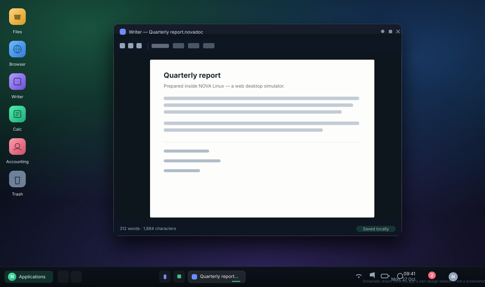

# NOVA Linux — Web Desktop Experience

A complete, interactive **Linux-style desktop environment that runs entirely in the browser**.
It boots, asks you to sign in, restores your workspace and lets you actually *work* inside it:
write documents, build spreadsheets, keep a Persian bookkeeping ledger, browse, take notes and
manage a virtual file system that survives a page reload.

> **This is a simulator.** NOVA Linux is a web application that imitates a desktop OS. It does not
> run a Linux kernel, cannot access your real files, your hardware or the network on your behalf,
> and it never asks for or stores a real password.

- **Stack:** React 18 + TypeScript (strict) + Vite 5, Zustand, Framer Motion (used sparingly),
  Lucide icons, hand-written CSS with design tokens, IndexedDB + LocalStorage persistence.
- **No backend, no API keys, no external services, no tracking.** Everything is client-side.
- **GitHub Pages ready** — builds with the correct sub-path base and deploys from Actions.

---

## Table of contents

1. [Screens](#screens)
2. [Feature tour](#feature-tour)
3. [Quick start](#quick-start)
4. [Deploying to GitHub Pages](#deploying-to-github-pages)
5. [Project structure](#project-structure)
6. [Persistence model](#persistence-model)
7. [Keyboard shortcuts](#keyboard-shortcuts)
8. [Testing](#testing)
9. [Honest limitations](#honest-limitations)
10. [Design notes](#design-notes)

---

## Preview



*Schematic of the desktop built from the project's own design tokens (wallpaper gradients, panel,
window chrome, icons) — not a screenshot. Open the live demo for the real thing.*

## Screens

| Screen | What it is |
| --- | --- |
| Boot splash | Firmware-style POST table (CPU/memory/display/storage), drifting aurora, CRT scanlines, a live service checklist, percentage meter, log lines and a **Skip** control. |
| Login | Large clock + date, wallpaper, avatar, password field with reveal toggle and a Caps-Lock indicator, language & keyboard layout selectors and a power menu. Demo mode: **any password works and nothing is stored**. |
| Desktop | Wallpaper, column-flowing desktop icons, panel, Applications menu, clock/calendar, notification tray, Quick Settings, window manager, and a cinematic session intro (rings, wordmark, sweep). Apps open at ~100% of the work area. |
| Lock screen | Same visual language as login, returns you to the running session without losing windows. |
| Power states | Shutting down / restarting / powered off, with a "Power on" action. |

The desktop layout is fluid: the panel can sit on the **bottom, top, left or right**, with adjustable
size, opacity and auto-hide, and the whole UI scales for small screens (windows become maximised
sheets on mobile widths).

### Desktop

The desktop is a real workspace, not a wallpaper:

- **An icon for every installed application** (14 out of the box), laid out in columns that grow to
  the right and scroll when the screen is small — add or remove any of them and the choice is saved.
- **Right-click the desktop** for *New folder / text file / document / spreadsheet / presentation /
  note*, *Add app shortcut…*, wallpaper and display settings, "show desktop" and "restore default
  icons". Anything created appears on the desktop immediately and opens in the right application.
- **Right-click an icon** for open, add/remove from desktop, pin to the panel, reorder, rename,
  properties or move to Trash. Right-click any app in the Applications menu to add it to the desktop.
- Keyboard: arrows/tab move focus, `Enter` opens, `F2` renames, `Delete` moves a file to the Trash.
- Double-click on a mouse, single tap on touch screens.

### Panel, sound and brightness

- A floating glass dock with launcher, pinned apps, running windows, network, **volume**, **brightness**,
  battery, notifications, calendar and a show-desktop button.
- The tray volume and brightness icons support the **mouse wheel**; both also live in Quick Settings.
- One on-screen display is shared by every surface, so the panel, Quick Settings and the Settings app
  can never disagree about the current level.
- Brightness dims the desktop layer only (a real display-brightness API does not exist in a browser);
  volume is simulated and clearly labelled as such.

---

## Feature tour

### Window manager
- Title bar with app icon + name, minimise / maximise / close, drag to move, eight-way resize.
- Click-to-focus with correct z-ordering and an active/inactive visual state.
- Double-click the title bar to maximise; drag to the top edge for a snap preview.
- Title-bar context menu (restore, snap left/right, close) and a desktop context menu.
- Windows are clamped inside the work area, cascade when opened, and re-clamp on resize.
- Multi-instance where it makes sense (Writer, Calc, Impress, Files, Terminal…), singletons for
  Settings, Welcome and the session shell.

### Applications menu
Favorites, All Applications, Recent, Internet, Office, Graphics, Multimedia, System, Utilities and
Development categories with live counts; fuzzy search across names, descriptions and categories;
pin/unpin; keyboard navigation (↑/↓/Enter/Esc); empty state; right-click a tile for *Open*,
*Pin* and *Open in new window*.

### Files ("Computer")
All home folders plus Desktop, Documents, Downloads, Pictures, Music, Videos, Notes, Favorites,
Recent, Applications and Trash. Grid and list views, icon size control, sorting, breadcrumbs,
back/forward/up, search, multi-select, drag & drop move, copy/cut/paste, duplicate, rename,
Move to Trash, restore, delete permanently, empty trash (with confirmation), details pane,
inline image preview, and a *New* menu that creates real files of every supported kind.

### Browser
Chrome-inspired but clearly its own thing: tabs (new/close/switch), back/forward/reload/home,
address bar with search fallback, bookmarks, history, downloads panel, custom new-tab page with a
clock and shortcuts. Sites that refuse to be embedded (`X-Frame-Options` / CSP) show an explanatory
screen with an "Open in your real browser" action instead of a broken frame.

### Office suite
- **Writer** — rich text editing (headings, bold/italic/underline, lists, alignment, colours,
  links, tables), find & replace, live word/character count, print preview + print, save into the
  virtual file system, export to TXT and HTML. DOCX/PDF export is deliberately **not** offered.
- **Calc** — 40 × 16 grid, formula bar, `SUM/AVERAGE/MIN/MAX/COUNT/ABS/ROUND/SQRT/PI`, arithmetic
  and ranges, dependent recalculation, circular-reference and unknown-function errors, cell styles
  (bold/italic/align/colour), row/column insert & delete, multiple sheets, CSV import/export.
- **Impress** — slide CRUD and reordering, layouts, text/shape inserts, themes, backgrounds,
  thumbnails, full-screen slide show with keyboard control, autosave and JSON export.

### Notes
Create, edit, search, pin, colour-code and delete notes; autosave with last-modified timestamps;
export to TXT; opens `.novanote` files from Files; Persian and English text.

### NOVA Accounting (Persian, RTL)
A working small-business ledger: dashboard with KPIs and a monthly chart, customers, suppliers,
products/services, sales and purchase invoices with line items (quantity, price, discount, tax),
derived payment status, partial payments, printing, income/expense transactions with filters,
payments, bank accounts, reports with CSV export, and settings with JSON backup/import.
Sample data ships pre-loaded **and is clearly labelled as sample data**, with one-click clearing.

### Settings
Appearance (theme, accent, corner radius, transparency), Desktop & Panel (position, size, opacity,
auto-hide, dock labels), Display (virtual resolution, UI scale, text size, fullscreen), Brightness
(desktop-layer dimming only), Wallpapers, Fonts, Keyboard layout, Language (English ⇄ فارسی with a
full RTL flip), Date & Time (24-hour, seconds), Notifications, Storage (export/import/backup/
restore/clear demo data with confirmations), Privacy, Accessibility (reduced motion) and About.

### System apps
Calculator (keyboard-friendly, history), Calendar (month view, events, colours), Terminal
(simulated shell over the virtual FS only: `help`, `ls`, `cd`, `pwd`, `mkdir`, `touch`, `cat`,
`echo >`, `history`, `neofetch`, `open`), System Monitor (clearly labelled **simulated** graphs),
Software Center (install/remove simulator apps, which updates the Applications menu), Trash,
and a Welcome window on first login.

---

## Quick start

Requirements: **Node 18+** (20 recommended) and npm.

```bash
npm install
npm run dev        # http://localhost:5173
```

Other scripts:

```bash
npm run typecheck  # strict TypeScript, no emit
npm run test       # Vitest + Testing Library (jsdom)
npm run build      # typecheck + production bundle into dist/
npm run preview    # serve the production build locally
```

---

## Deploying to GitHub Pages

1. Push the repository to GitHub (suggested name: `nova-linux-web`).
2. **Settings → Pages → Build and deployment → Source: GitHub Actions.**
   This is the one setting that cannot be automated: the workflow token is not allowed to create
   the Pages site, so `configure-pages` can only *configure* an existing one. Until it is flipped,
   the run stops at **Configure Pages** with a `404` from the Pages API.
3. Push to `test` (this repository's default branch), to `main`, or run the workflow manually with
   **Run workflow**. `.github/workflows/deploy.yml` will type-check, run the tests, verify the Pages
   status, build with `VITE_BASE=/<repo-name>/`, add `.nojekyll`, upload `dist` and deploy it.

The live URL is `https://<user>.github.io/<repo>/`. If a run fails only at *Configure Pages*, the
build is fine — enable Pages and press **Re-run all jobs**.

The Vite `base` comes from `VITE_BASE`, so the same code works at a project sub-path
(`https://user.github.io/<repo>/`) **and** at a domain root. There are no absolute asset URLs in the
bundle — fonts are bundled locally through `@fontsource-variable`, icons are inline SVG components,
and wallpapers are pure CSS gradients.

For a custom domain, set `VITE_BASE=/` in the workflow environment.

---

## Project structure

```
src/
  app/                    App shell + phase machine (boot → login → desktop → locked → off)
  components/
    desktop/              Desktop surface, icons, context menus, intro animation
    windows/              WindowFrame (drag/resize/snap) + WindowManager
    taskbar/              Panel (positions, tray, task list, clock)
    start-menu/           Applications menu
    quick-settings/       Quick Settings popover
    notifications/        Notification center + calendar popover
    screens/              Boot and login screens
    common/               NovaLogo, AppIcon, Modal, ContextMenu, Toasts, FilePicker, Controls…
  apps/
    files/ browser/ writer/ calc/ impress/ notes/ accounting/
    settings/ terminal/ calculator/ calendar/ software-center/
    system-monitor/ welcome/
  core/
    apps/                 App metadata, registry (the app contract), launcher + shell stores
    window-manager/       Window store + responsive metrics
    virtual-filesystem/   FS store, seed image, path helpers, clipboard
    persistence/          IndexedDB wrapper (kv store) + React bindings
    themes/               Settings store + theme application
    localization/         i18n (English keys → Persian values), localized dates
    notifications/        Notification store
  hooks/ services/ styles/ types/ utils/
tests/                    Vitest suites (core logic, apps, shell)
docs/                     Architecture, testing checklist, shortcuts
public/                   Logo, PWA manifest, robots.txt
```

**Adding an app** only needs: metadata in `core/apps/appMeta.ts`, a component accepting
`AppWindowProps` (`{ win }`), and one line in `core/apps/registry.ts`. Everything else — window
handling, launcher entry, search, pinning, software center, persistence helpers — is generic.

---

## Persistence model

| Data | Where | Notes |
| --- | --- | --- |
| Virtual file system (documents, notes, images, trash) | **IndexedDB** (`nova-linux-web`, versioned) | Falls back to an in-memory store when storage is blocked; the UI then shows a warning banner and says changes are session-only. |
| App data (browser tabs/history/bookmarks, accounting ledger, calendar) | **IndexedDB** key-value stores | Versioned keys such as `app.browser.v1`, `app.accounting.v1`. |
| UI preferences (theme, accent, wallpaper, panel, language, accessibility) | **LocalStorage** (`nova-linux.settings.v1`) | Small, synchronous, safe to lose. |
| Session phase | `sessionStorage['nova.session']` | `active` / `locked` only — **no credentials, ever**. |

Storage → Settings offers JSON export/import of the whole workspace (settings, launcher, files and
app data) plus a "clear demo data" action that always asks for confirmation.

---

## Keyboard shortcuts

| Shortcut | Action |
| --- | --- |
| `Ctrl/Cmd + K` | Open the Applications menu |
| `Ctrl + Alt + T` | Open Terminal |
| `Alt + Tab` | Switch to the next window |
| `Ctrl + Alt + L` | Lock the session |
| `Esc` | Close the open menu / dialog |
| `Delete`, `F2`, `Enter`, `Ctrl+A/C/V` | Files: delete, rename, open, select-all, copy/paste |
| `Ctrl + S` | Save in Writer / Calc / Impress |
| Arrow keys, `Esc` | Slide-show navigation |

---

## Testing

```bash
npm run test
```

The suite runs in `jsdom` with Testing Library and covers:

- utilities, the formula engine and the spreadsheet engine (including error cases),
- virtual file system CRUD, trash/restore and unique-name handling,
- accounting totals, invoice status derivation and sample-data handling,
- the boot → login → desktop flow, the Applications menu, Quick Settings,
- every registered app rendering without crashing, plus **every Accounting tab** and **every Settings
  section**,
- the desktop surface: an icon for every installed application, column layout, adding/removing app
  shortcuts, and files created from the desktop context menu showing up immediately,
- volume and brightness: the slider track fill follows the value, the Quick Settings control and the
  settings store agree, and both surfaces raise the same on-screen display,
- real interactions: Terminal commands (and the `sudo` refusal), Notes autosave, Files folder
  creation through the dialog, Trash restore, Accounting create/validate, Calculator keypad,
  Browser navigation (including the iframe-blocked path), Software Center install/uninstall,
  Calendar events, Settings language & reduced motion, theme/accent persistence.

`docs/TESTING.md` contains the full 30-point manual behaviour checklist used for the release pass.

---

## Honest limitations

NOVA Linux is deliberately honest about what it cannot do:

- **No real OS, kernel, hardware or network access.** Terminal is a simulator over the virtual FS;
  System Monitor graphs and battery/network readings are synthetic and labelled as such.
- **No real browsing session.** The Browser can display pages that explicitly allow embedding; many
  sites block it, in which case you get a clear explanation and a link for your real browser. There
  is no proxy, no server-side fetch and no cookie jar.
- **No DOCX/PDF import/export.** Writer exports TXT and HTML, and printing uses the browser's own
  print dialog. Nothing pretends to produce documents it cannot.
- **No real authentication.** The login screen is a demo: any password works, nothing is validated
  or stored. Passwords typed there never leave the component.
- **Brightness** dims the desktop layer only (a real display brightness API does not exist in a
  browser).
- **Virtual resolution** is a simulated canvas — it changes layout metrics, not your display.
- Downloadable files are generated in-memory and handed to the browser; there is no server upload.

---

## Design notes

- One CSS-variable design system (`styles/tokens.css`): colours, radii, shadows, motion and layout
  metrics. Themes and accents swap tokens only — no component knows a hex value.
- Dark-first, with a full light theme; accent palettes (mint, sky, violet, amber, rose); Persian uses
  Vazirmatn and the whole document flips to RTL with logical CSS properties.
- Motion is cheap and optional: reduced-motion is honoured both from Settings and from
  `prefers-reduced-motion`, and heavy effects are avoided on the compositor path.
- Every interactive element does something real: no placeholder buttons, no fake success toasts.
  Empty, loading, error and confirmation states exist throughout.

---

Built as a portfolio-grade demonstration that a desktop-class experience can live inside a single
static web page. Not affiliated with any operating-system vendor; "Chrome-inspired" only describes a
browser layout, and NOVA is not Chrome or Chromium.
